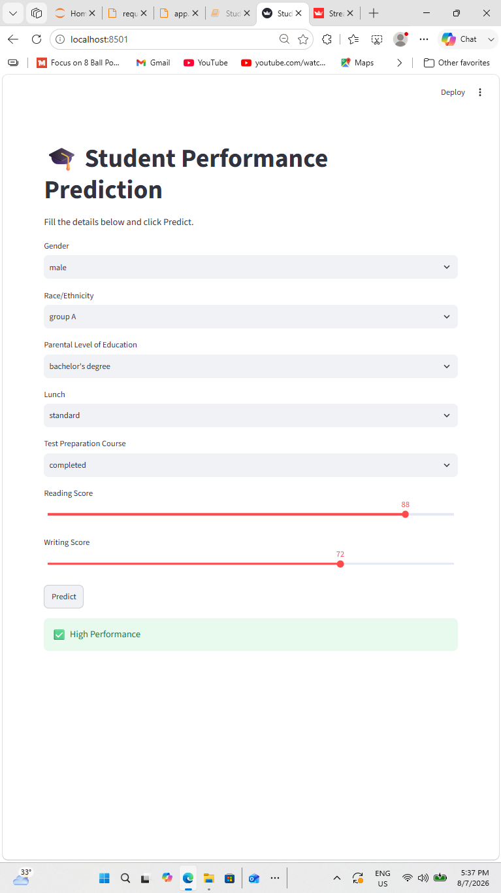

# 🎓 Student Performance Prediction | Machine Learning & Streamlit

A machine learning project that classifies student academic performance as **High Performance** or **Low Performance** using demographic, educational, and reading/writing score information. The project includes an exploratory Jupyter Notebook, model comparison, a trained Random Forest model artifact, and an interactive Streamlit application.

## Project Overview

Educational institutions can use early indicators to identify students who may benefit from additional academic support. This project explores a binary classification approach using the Students Performance dataset.

The target is created from the mathematics score:
- **High Performance (1):** Mathematics score is 60 or above.
- **Low Performance (0):** Mathematics score is below 60.

The mathematics score is removed from the input features after creating the target. The model predicts the target category using the remaining available features.

> **Important:** This is an academic demonstration, not a validated tool for making high-impact decisions about students.

## Dataset

- **File:** `data/StudentsPerformance.csv`
- **Records:** 1,000
- **Features:** Gender, race/ethnicity, parental level of education, lunch type, test preparation course, mathematics score, reading score, and writing score.
- **Target:** Binary performance label derived from mathematics score.

The notebook checks dataset structure, summary statistics, and missing values, and includes exploratory visualizations.

## Machine Learning Workflow

1. Load and inspect the dataset.
2. Perform exploratory data analysis (EDA).
3. Create the binary performance target using the mathematics score threshold.
4. Remove the mathematics score from the predictors.
5. Encode categorical features using Label Encoding.
6. Split the data into training and test sets (80/20, `random_state=42`).
7. Train and evaluate classification models.
8. Save the Random Forest estimator as `models/model.pkl`.
9. Run an interactive prediction interface using Streamlit.

## Model Comparison

The notebook reports the following test-set accuracy scores:

| Model | Accuracy |
|---|---:|
| Logistic Regression | **91.0%** |
| Random Forest Classifier | 87.5% |
| Decision Tree Classifier | 86.0% |

**Notebook result:** Logistic Regression achieved the highest recorded accuracy in this experiment. The notebook also saves a Random Forest model artifact (`models/model.pkl`).

Accuracy is based on the notebook's single 80/20 train-test split. It is not a guarantee of performance on new or unseen student populations.

## Streamlit Application

The app collects:
- Gender
- Race/ethnicity group
- Parental education level
- Lunch type
- Test preparation status
- Reading score
- Writing score

After the user selects **Predict**, the app displays either **High Performance** or **Low Performance**.

**Implementation note:** The current `app.py` trains a Random Forest classifier when the app starts. It does not load the saved `models/model.pkl` file. The notebook's model comparison and the app's current training path are therefore separate implementations.

## Technology Stack

- **Language:** Python
- **Data analysis:** Pandas, NumPy
- **Visualization:** Matplotlib, Seaborn
- **Machine learning:** Scikit-learn
- **Web application:** Streamlit
- **Development:** Jupyter Notebook

## Repository Structure

```text
student-performance-prediction-ml/
├── app.py
├── data/
│   └── StudentsPerformance.csv
├── models/
│   └── model.pkl
├── notebook/
│   └── Student_Performance_Prediction.ipynb
├── screenshots/
│   ├── app.png
│   ├── Screenshot 2026-08-07 173926.png
│   └── Screenshot 2026-08-07 173948.png
├── requirements.txt
├── runtime.txt
└── README.md
```

## Screenshots

### Streamlit Application


### Project / Notebook


## Getting Started

### 1. Clone the repository

```bash
git clone https://github.com/Hashir2022/student-performance-prediction-ml.git
cd student-performance-prediction-ml
```

### 2. Create and activate a virtual environment

**Windows PowerShell**
```powershell
python -m venv .venv
.\.venv\Scripts\Activate.ps1
```

**macOS / Linux**
```bash
python -m venv .venv
source .venv/bin/activate
```

### 3. Install dependencies

```bash
pip install -r requirements.txt
```

### 4. Launch the Streamlit app

```bash
streamlit run app.py
```

The application should open in your browser. Keep `data/StudentsPerformance.csv` in its repository location so the app can load the dataset.

## Future Improvements

- Load the persisted model and preprocessing pipeline instead of retraining on every app launch.
- Use a consistent preprocessing pipeline (for example, `ColumnTransformer` and `OneHotEncoder`) for training and inference.
- Add stratified cross-validation and report precision, recall, F1-score, and a confusion matrix.
- Review feature selection and potential demographic bias before any real-world use.
- Add clearer prediction explanations and model limitations in the app.

## Author

**Hashir Ahmed Buriro**  
Software Engineer | Machine Learning & Data Analysis

- GitHub: [Hashir2022](https://github.com/Hashir2022)
- LinkedIn: [Engr. Hashir Ahmed Buriro](https://www.linkedin.com/in/engr-hashir-ahmed-buriro/)

---

If you find this project useful, feel free to star the repository or connect with me.
